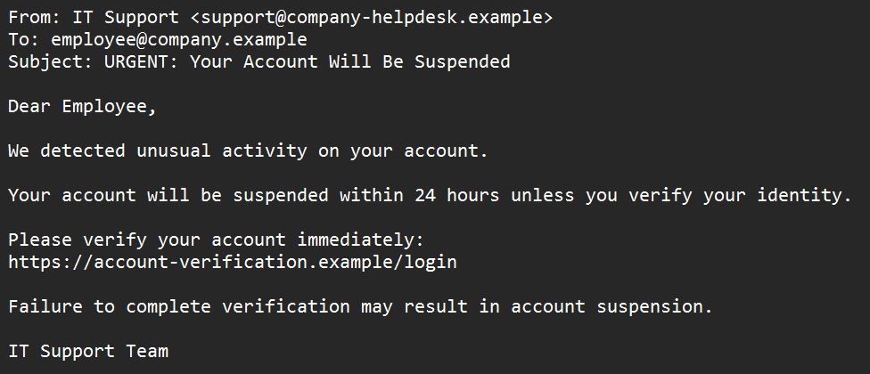
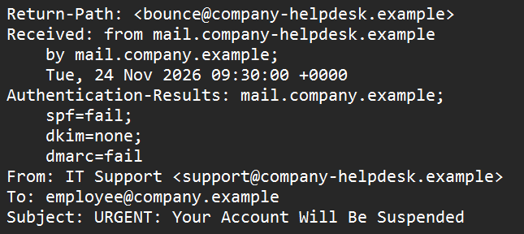
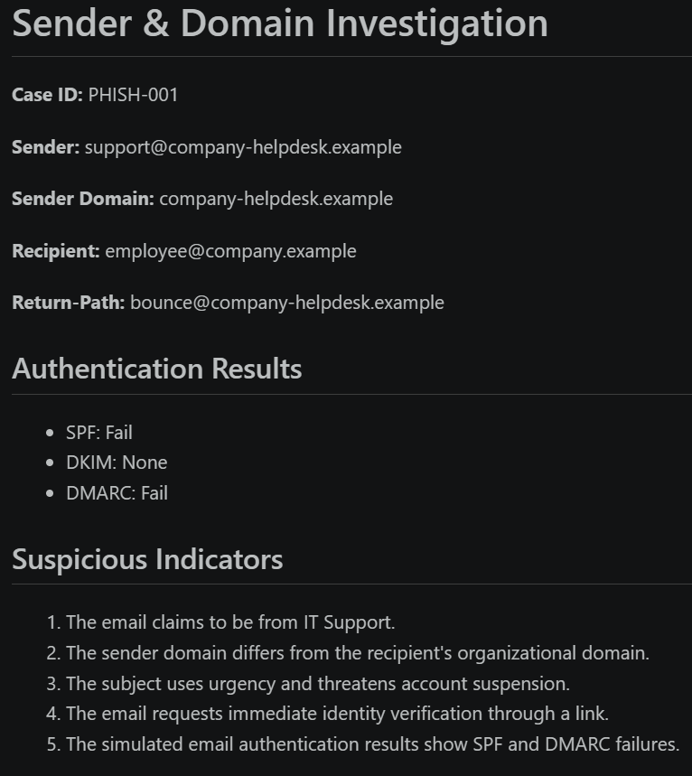
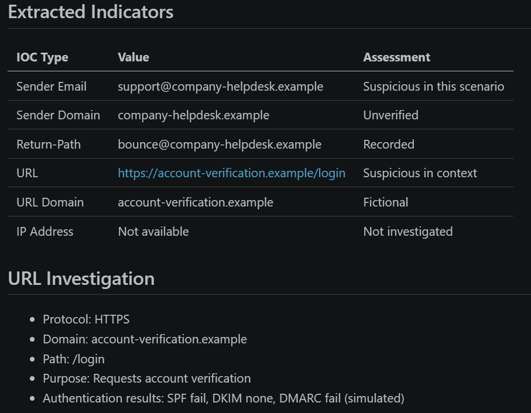
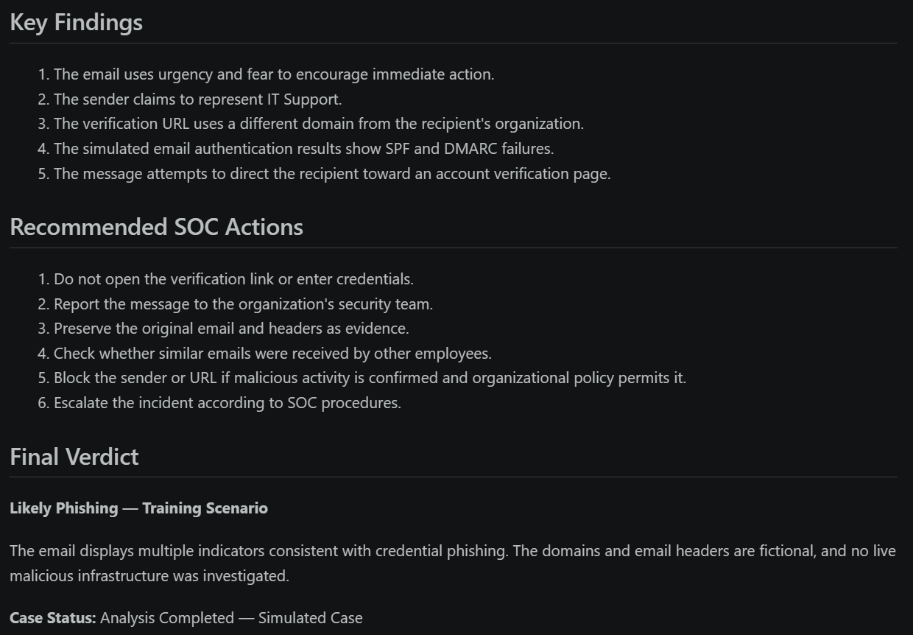
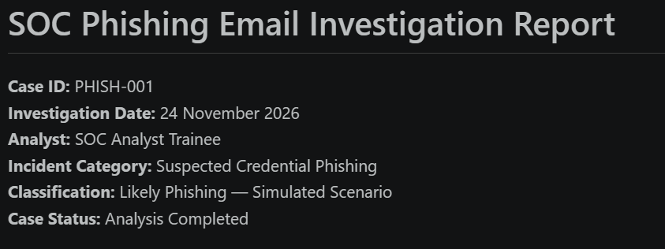

#  Phishing Email Investigation | SOC Analyst Portfolio Project

##  Project Overview

This project demonstrates fundamental Security Operations Centre (SOC) investigation skills through two email security analysis exercises:

1. **Simulated Phishing Investigation:** Analysis of a fictional phishing email, including suspicious indicators, simulated authentication failures, and incident documentation.
2. **Hands-on Email Security Analysis:** Examination of a real marketing email using Gmail's Show Original feature, sender authentication checks, and manual URL inspection.

The project focuses on evidence-based assessment rather than assuming every suspicious email is malicious.

##  Objectives

- Identify common phishing and social engineering indicators.
- Understand SPF, DKIM, and DMARC.
- Examine email headers and sender information.
- Extract suspicious domains and URLs.
- Practice safe URL inspection.
- Document findings and security recommendations.
- Produce structured SOC investigation reports.

##  Tools Used

- Gmail — Show Original
- Google Chrome
- Visual Studio Code
- Windows 11
- Markdown

##  Investigation 01 — Simulated Phishing Email

**Case ID:** PHISH-001

A fictional email impersonating IT Support was reviewed for suspicious indicators.

### Findings

- Urgent account suspension warning
- IT Support impersonation
- Account verification request
- Suspicious verification link in the simulated scenario
- Simulated SPF and DMARC failures

**Verdict:** Likely Phishing — Simulated Training Scenario

All domains and authentication results were created for training purposes.

##  Investigation 02 — Hands-on Email Security Analysis

**Case ID:** EMAIL-002

A real Uber Eats marketing email was examined using Gmail's Show Original feature.

### Authentication Results

| Check | Result |
|---|---|
| SPF | PASS |
| DKIM | PASS |
| DMARC | PASS |

### URL Analysis

- Sender Domain: `uber.com`
- Link Hostname: `email.mgm.uber.com`
- Protocol: HTTPS
- Tracking/Redirect: Likely
- Final Redirect Destination: Not independently verified

### Additional Observations

- No urgency or threatening language reported
- No attachments observed
- No obvious phishing indicators identified during the checks performed

**Preliminary Verdict:** Likely Legitimate Marketing Email

This assessment is limited to the evidence examined and does not constitute a guarantee of email safety.

##  Project Structure

```text
Project-04-Phishing-Email-Investigation/
├── README.md
├── analysis/
├── evidence/
├── samples/
├── report/
└── hands-on-lab/
    ├── samples/
    ├── findings/
    └── screenshots/
```

##  Evidence

### Simulated Phishing Investigation

**Evidence 01 — Email Overview**



**Evidence 02 — Email Headers**



**Evidence 03 — Sender and Domain Analysis**



**Evidence 04 — IOC Analysis**



**Evidence 05 — Final Verdict**



**Evidence 06 — Investigation Report**



---

### Hands-on Email Security Investigation

**Evidence 07 — Real Email Header Analysis**


**Evidence 08 — URL Investigation**


**Evidence 09 — Authentication Results**


**Evidence 10 — Investigation Findings**


##  Skills Demonstrated

- Email Security Fundamentals
- SPF, DKIM and DMARC Interpretation
- Phishing Indicator Identification
- Sender and Domain Analysis
- Manual URL Inspection
- Evidence Documentation
- SOC Investigation Reporting

##  Scope and Limitations

The first case uses fictional training data. The second case examines a real email, but does not include complete forensic analysis, independent reputation verification, or full redirect-chain investigation.

Personal information and tracking identifiers have been redacted from the evidence screenshots.

##  Conclusion

This project strengthened fundamental SOC investigation skills by comparing a simulated phishing scenario with an authenticated real-world marketing email.

The investigation demonstrates the importance of evaluating email authentication, sender information, message content, and URL structure before reaching a security assessment.
